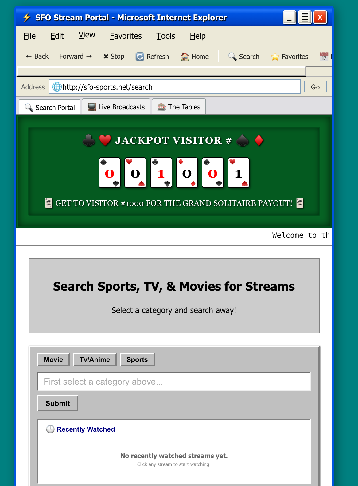
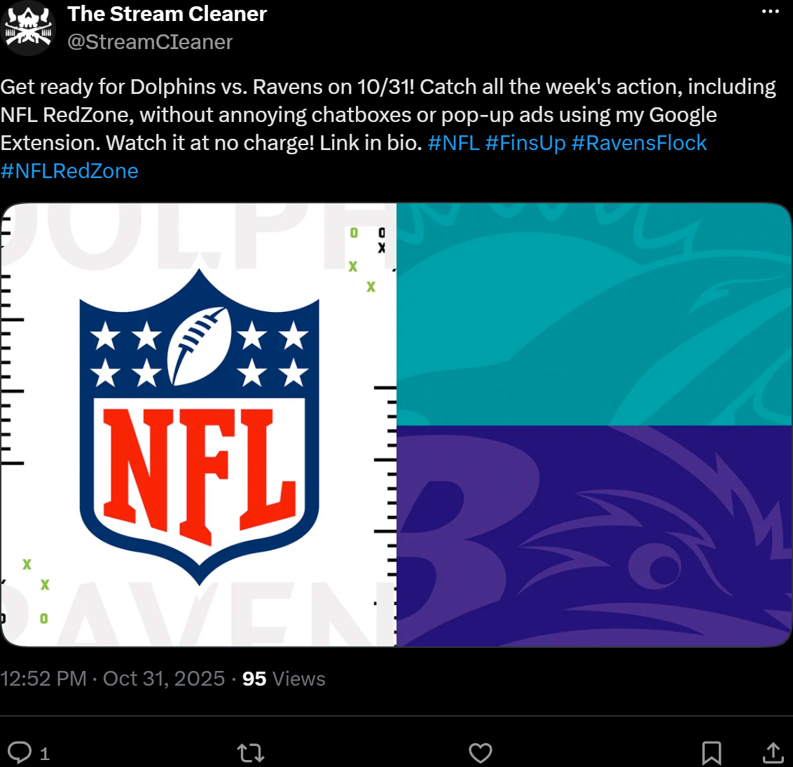
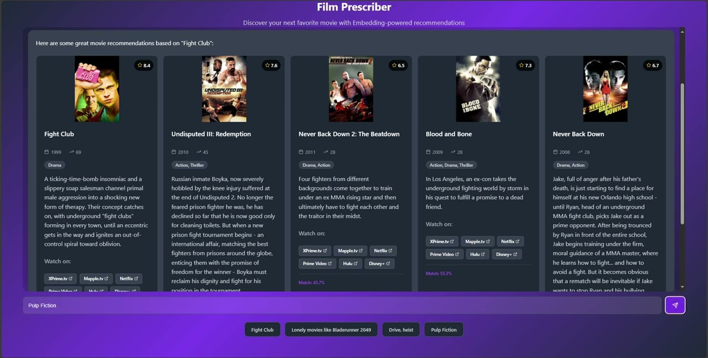

# Work Experience

## Software Engineering Intern — Enlighten Texas

**May 2026 – August 2026 · Texas**  
**Technologies:** Kotlin, Apache NiFi, Groovy, AWS S3, Docker, Git CI/CD

Developed, tested, and deployed production software and data pipelines within an Agile 10-engineer team across the full SDLC to improve large-scale data-processing speed and reliability.

- Built one-pass, two-pointer Kotlin parsers that extracted and normalized fields from more than 30 GB of malformed logs each day.
- Engineered a custom Apache NiFi and Groovy processor that used `HashMap` lookups to classify, track, and route more than 30,000 files per day to their target parsers.
- Standardized release versioning through Git and CI/CD pipelines that generated `YYMM.patch` tags automatically.
- Optimized Docker workflows and pipeline caching, reducing development-branch builds from more than 30 minutes to about 10 minutes.
- Overhauled production publishing to AWS S3, reducing deployment time from about 10 minutes to about 30 seconds while eliminating data redundancy.

## Software Engineering Intern — NerdsToGo

**May 2025 – August 2025 · Plano, Texas**  
**Technologies:** JavaScript, Python, Pandas, SQL, Chrome Extensions API, ConnectWise  
**Links:** [ConnectWise Autofill on the Chrome Web Store](https://chromewebstore.google.com/detail/connectwise-company-autof/cnfcgoakbimccopoicidkceoddfakdae) · [Extension source](https://github.com/henrynguyen50/ConnectWiseAutofill) · [ClientCleanup source](https://github.com/henrynguyen50/ClientCleanup)

Engineered internal automation tools and streamlined technician operations across client management and support infrastructure.

- Built a JavaScript, HTML, and CSS browser extension that automated technician ticket entry, cutting manual data entry by 80%, eliminating ticket-creation errors, and saving more than three hours each week.
- Created a Python, Pandas, and SQL ETL workflow to extract, normalize, and synchronize client records, reducing monthly account follow-up work from a full day to a few hours.
- Replaced legacy manual IT routines with automated background scripts to reduce operational friction and data-sync delays.

# Projects

## [AgentSmark — AI Streaming Assistant and Live Sports Engine](https://systemfiguredout.cc)

**October 2025 · Production deployment with 100+ active users**  
**Technologies:** React, TypeScript, FastAPI, Google Gemini, PostgreSQL, Docker, AWS Lightsail, HLS/DASH

Full-stack live-sports and media-discovery engine integrating low-latency LLM tool calling, reverse-engineered streaming protocols, and real-time data pipelines.

- Integrated Google Gemini tool calling with REST endpoints, translating natural-language queries into verified stream embeds and reducing content discovery from 1–3 minutes to under 10 seconds.
- Reverse-engineered an obfuscated streaming protocol and built a Python backend with a custom 32-bit bitwise keystream decoder for native HLS/DASH playback.
- Built a FastAPI service with HMAC-SHA256 signed tokens and socket-level SSRF safeguards that rewrites playlists and streams media in 64 KiB chunks.
- Automated scheduled ingestion with Python, SQL, and PostgreSQL to normalize and cache live game and stream metadata.
- Containerized the application with Docker and deployed it to AWS Lightsail through an automated build-and-deploy pipeline.

## [WhyKnot — Market Analysis Platform](https://devpost.com/software/whyknot)

**November 2025 · HackPrinceton**  
**Technologies:** Next.js, React, FastAPI, MongoDB, Knot API, Leaflet  
**Links:** [Devpost](https://devpost.com/software/whyknot) · [Frontend source](https://github.com/henrynguyen50/whyknot-frontend) · [Backend source](https://github.com/henrynguyen50/food-heatmap)

Geospatial market-intelligence platform that turns restaurant transaction data into expansion insights.

- Ingested and transformed multi-market delivery data from more than 100 restaurants through the Knot API.
- Built interactive React and Leaflet heatmaps to visualize order density and category trends, surfacing high-demand areas and pricing opportunities 50% faster than manual analysis.
- Developed a Python and FastAPI backend backed by MongoDB for normalized, multi-market aggregate queries.

## [Team Impact Connection Platform](https://github.com/henrynguyen50/Team-13)

**October 2025 · JPMorgan Code for Good**  
**Technologies:** React, FastAPI, Google Gemini, Python REST APIs  
**Link:** [Source repository](https://github.com/henrynguyen50/Team-13)

Nonprofit matching platform connecting participating colleges and athletic programs with children who have serious illnesses.

- Automated contact extraction and processing across universities and medical centers, increasing outreach capacity from 10–15 contacts per day to more than 100.
- Integrated Google Gemini to match compatible organizations and draft customized communications.
- Built Python and FastAPI endpoints to reduce coordination bottlenecks for partner nonprofits.

## [AIMarketingAgent](https://github.com/henrynguyen50/AIMarketingAgent)

**Technologies:** Python, FastAPI, Gemini 2.0 Flash, Sentence Transformers, NumPy, Tweepy, TheSportsDB API  
**Links:** [Source repository](https://github.com/henrynguyen50/AIMarketingAgent) · [Published example](https://x.com/StreamCIeaner/status/1984317501715460158) · [Output profile](https://x.com/StreamCIeaner)

Automated X marketing agent for The Stream Cleaner Chrome extension. It gathers current sports-event context, retrieves the most relevant event with sentence embeddings, generates date-aware promotional copy, and publishes it with optional event artwork.

- Fetches each configured league’s next event from TheSportsDB, falls back to its most recent event, stores event and match-card text, and downloads available artwork. Its configured leagues include AEW, WWE, NJPW, STARDOM, NFL, NBA, and MLB.
- Encodes event records with `sentence-transformers/paraphrase-albert-small-v2`, persists the vectors in NumPy format, and performs top-one semantic retrieval for a requested promotion.
- Uses Gemini 2.0 Flash to produce an original post under 280 characters with relevant hashtags, event-date-aware tense, a product call to action, and `Link in bio.` as the ending.
- Exposes rate-limited FastAPI generation and publishing endpoints and uses Tweepy to send either text-only or image-attached posts through the X API.

## [FilmPrescribe](https://github.com/henrynguyen50/FilmPrescribe)

**Technologies:** React 19, Vite 7, JavaScript, Python, FastAPI, Sentence Transformers, NumPy  
**Links:** [Source repository](https://github.com/henrynguyen50/FilmPrescribe) · [Demonstration video](https://www.youtube.com/watch?v=P_VBkn7Lmq4)

Embedding-powered movie recommender that turns free-text prompts into five visually rich suggestions with movie metadata, match scores, and links for searching major streaming services.

- Accepts conversational requests such as “Lonely movies like Bladerunner 2049” through a chat-style React interface.
- Uses Sentence Transformers’ `all-MiniLM-L6-v2` model and cosine similarity against precomputed embeddings built from titles, overviews, genres, keywords, and taglines.
- Selects the 20 most similar candidates, sorts that candidate set by popularity, and returns five recommendations.
- Presents posters, titles, ratings, release years, popularity, genres, synopses, embedding-match percentages, and external search links for XPrime.tv, Mapple.tv, Netflix, Prime Video, Hulu, and Disney+.
